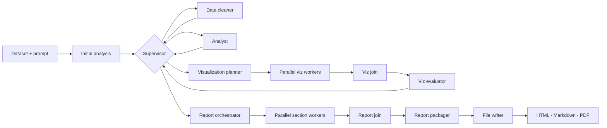

# 🕵️ Intelligent Data Detective

[](https://opensource.org/licenses/MIT)
[](https://www.python.org/downloads/)
[](https://python.langchain.com/)
[](https://langchain-ai.github.io/langgraph/)

> **An intelligent multi-agent system that transforms raw data into actionable insights through automated data cleaning, exploratory analysis, visualization, and comprehensive reporting.**

## 🎯 Overview

Intelligent Data Detective (IDD) is a multi-agent analytical workflow built with LangChain and LangGraph. It combines specialized LLM agents, executable data-science tools, shared state, memory, and independently checked report artifacts to automate much of the data investigation process.

### 🚀 What It Does

- **🧹 Automated Data Cleaning**: Intelligently identifies and resolves data quality issues
- **📊 Exploratory Data Analysis (EDA)**: Performs comprehensive statistical analysis and pattern discovery
- **🎨 Dynamic Visualization**: Creates relevant charts and graphs based on data insights
- **📝 Intelligent Reporting**: Generates structured, narrative reports with explanations
- **🧭 Structured Planning and Progress**: Maintains observable plans, routing decisions, tool activity, and progress records
- **🌐 Contextual Web Search**: Enriches analysis with relevant external information

### 💡 Key Innovation

IDD combines **specialized AI agents** with constrained LangGraph routing, parallel worker/join stages, structured contracts, memory and quality validators. These mechanisms make analytical work more inspectable; they are not by themselves a guarantee of factual correctness.

### 📚 Full Feature Catalog and Current Status

For the inventory of **40 analytical tools, 15 graph nodes, memory systems, development tooling, validation gates, innovations, limitations, and roadmap**, see **[FEATURES.md](FEATURES.md)**.

**Current iteration (October 20, 2026):** CP4 is merged ([PR #163](https://github.com/dhar174/intelligent_data_detective/pull/163)). The v5 architecture uses a **99-cell runnable notebook, 70-field shared state and 15-node / 33-edge LangGraph**. The generated notebook imports canonical Python modules, protected by anti-drift guards.

**Verification boundary:** no-key CI and structural checks have passed on the reviewed CP4 revision, but **fresh full post-CP4 production runs have not been certified**. The [cross-platform real-kernel matrix (#164)](https://github.com/dhar174/intelligent_data_detective/issues/164), [two-run CP5 proof (#165)](https://github.com/dhar174/intelligent_data_detective/issues/165), and [analytical fidelity benchmark (#167)](https://github.com/dhar174/intelligent_data_detective/issues/167) remain open.

## 🏗️ Architecture

### Multi-Agent System Design



*Simplified main execution path. The actual graph has 15 nodes, 33 edges, conditional routes, emergency messaging and additional completion paths. See [FEATURES.md](FEATURES.md#2-multi-agent-runtime-and-graph-orchestration).*

### 🤖 Agent Roles & Responsibilities

#### 🎯 **Supervisor Agent (Controller)**
- **Role**: Orchestrates the entire workflow and coordinates agent interactions
- **Responsibilities**: 
  - Manages task delegation and sequencing
  - Monitors agent completion status
  - Maintains global state and memory
  - Makes routing decisions based on current progress

#### 🧹 **Data Cleaner Agent**
- **Role**: Performs intelligent data preprocessing and quality assurance
- **Capabilities**:
  - Missing value detection and imputation strategies
  - Outlier identification and handling
  - Data type conversions and standardization
  - Duplicate detection and removal
  - Column name standardization
- **Tools**: pandas, numpy, custom data quality assessment tools
- **Output**: Cleaned dataset + detailed metadata about cleaning actions taken

#### 📊 **Analyst Agent**
- **Role**: Conducts comprehensive exploratory data analysis
- **Capabilities**:
  - Descriptive statistics computation
  - Correlation analysis and feature relationships
  - Anomaly and pattern detection
  - Hypothesis testing (normality, t-tests)
  - Basic machine learning model training
  - Data quality assessment
- **Tools**: pandas, scipy.stats, scikit-learn, custom analysis tools
- **Output**: Structured insights, correlations, anomalies, and visualization recommendations

#### 🎨 **Visualization Agent**
- **Role**: Creates compelling and relevant data visualizations
- **Capabilities**:
  - Histogram generation for distribution analysis
  - Scatter plots for relationship exploration
  - Correlation heatmaps for feature relationships
  - Box plots for outlier visualization
  - Dynamic chart selection based on data types and insights
- **Tools**: matplotlib, seaborn, base64 encoding for web compatibility
- **Output**: Generated visualizations with descriptive captions

#### 📝 **Report Generator Agent**
- **Role**: Synthesizes all findings into comprehensive, actionable reports
- **Capabilities**:
  - Multi-format report generation (HTML, Markdown, PDF)
  - Narrative synthesis from agent findings
  - Visual integration with explanatory text
  - Executive summary creation
  - Recommendation generation
- **Tools**: Jinja2 templating, xhtml2pdf, custom formatting tools
- **Output**: Professional reports combining text, statistics, and visualizations

## ✨ Features

### 🎯 **Core Features (Implemented in Code)**

*Implemented capabilities may still require environment configuration or current-head live validation. See [FEATURES.md](FEATURES.md#1-capability-at-a-glance) for evidence-qualified status.*

#### 🔄 **Automated Workflow Orchestration**
- Intelligent task routing between specialized agents
- State management with checkpointing and recovery
- Checkpoint/store integration and memory retrieval (durability depends on the configured backend)
- Real-time streaming updates during processing

#### 🧠 **Structured Planning and Traceability**
- Supervisor planning, replanning, and completion accounting
- Structured routing, state updates, and agent/tool activity logs
- Prompt and output contracts for inspectable results
- Run and validator evidence for reproducibility, subject to proper capture

#### 📈 **Comprehensive Data Analysis**
- **Statistical Analysis**: Descriptive statistics, correlation matrices, hypothesis testing
- **Quality Assessment**: Missing value analysis, duplicate detection, data type validation
- **Pattern Recognition**: Anomaly detection, trend identification, relationship discovery
- **Machine Learning**: Basic classification and regression model training

#### 🎨 **Dynamic Visualization Generation**
- **Adaptive Chart Selection**: Automatically chooses appropriate visualization types
- **Preview Support**: Base64-encoded images for embedding and preview in reports
- **Custom Styling**: Configurable themes and color schemes
- **Figure Outputs**: PNG artifacts and embedded visualizations for generated reports

#### 🌐 **Contextual Intelligence**
- **Web Search Integration**: Tavily API for external context and domain knowledge
- **Domain-Specific Insights**: Retrieval of relevant best practices and guidelines
- **Historical Learning**: Memory of past analysis patterns and decisions

#### 📊 **Flexible Data Handling**
- **Multiple Format Support**: CSV/JSON multi-file import, CSV/JSON/Parquet/trusted Pickle registry reload, and CSV/Excel/JSON/Parquet export
- **Large Dataset Optimization**: Efficient memory management and processing
- **Data Registry System**: Centralized DataFrame management with LRU caching
- **Merge and Join Operations**: Multi-dataset analysis capabilities

### 🔮 **Future Features (Roadmap)**

#### 🚀 **Phase 2: Enhanced Intelligence**
- **Advanced RAG Implementation**: Vector database integration for domain knowledge
- **Interactive Dashboard**: Real-time data exploration interface
- **Multi-dataset Comparative Analysis**: Cross-dataset insights and relationships
- **Advanced ML Pipeline**: Automated feature engineering and model selection

#### 🔐 **Phase 3: Enterprise Features**
- **Multi-user Authentication**: Secure user management and access control
- **Scheduled Analysis**: Automated recurring analysis jobs
- **Data Privacy Controls**: Field masking and anonymization capabilities
- **Observability Dashboard**: System monitoring and performance metrics

#### 🌟 **Phase 4: Advanced Analytics**
- **Real-time Data Streaming**: Live data analysis capabilities
- **Predictive Analytics**: Forecasting and trend prediction models
- **Natural Language Queries**: Conversational data exploration
- **Custom Agent Development**: User-defined specialized agents

## 🛠️ Technology Stack

### **Core Framework**
- **Python 3.12+**: Recommended maintained notebook/validation environment
- **LangChain**: LLM application framework and tool integration
- **LangGraph**: Multi-agent workflow orchestration
- **OpenAI Responses API**: v5 notebook model-role configuration uses GPT-5 mini/nano; an optional local OpenAI-compatible pathway exists but is not fully cross-provider validated

### **Data Processing & Analysis**
- **pandas**: Data manipulation and analysis
- **numpy**: Numerical computing and array operations
- **scipy**: Statistical analysis and hypothesis testing
- **scikit-learn**: Machine learning algorithms and model training

### **Visualization & Reporting**
- **matplotlib**: Comprehensive plotting library
- **seaborn**: Statistical data visualization
- **Jinja2**: Template engine for report generation
- **xhtml2pdf**: PDF report generation from HTML

### **Integration & Storage**
- **Tavily API**: Web search and external context retrieval
- **FAISS/Chroma**: Vector database for RAG implementations (future)
- **Memory and Checkpointing**: LangGraph store/checkpoint interfaces; persistence depends on the configured backend
- **File I/O**: Multiple format support (CSV, JSON, Excel)

### **Development & Deployment**
- **Jupyter Notebooks**: Interactive development environment
- **Pydantic**: Data validation and serialization
- **asyncio**: Asynchronous processing capabilities
- **Docker**: Containerization support (planned)

## 🚀 Quick Start

### Prerequisites

- Python 3.12 or higher for the maintained validation scripts and notebook workflow
- OpenAI API key
- Tavily API key (optional, for web search features)

### Installation

1. **Clone the repository**:
   ```bash
   git clone https://github.com/dhar174/intelligent_data_detective.git
   cd intelligent_data_detective
   ```

2. **Set up environment variables**:
   ```bash
   export OPENAI_API_KEY="your-openai-api-key"
   export TAVILY_API_KEY="your-tavily-api-key"  # Optional
   ```

3. **Install dependencies**:
   ```bash
   pip install langchain langchain-core langchain-openai langchain_experimental langgraph
   pip install pandas numpy scipy scikit-learn matplotlib seaborn
   pip install pydantic python-dotenv tiktoken openpyxl xhtml2pdf
   pip install tavily-python chromadb joblib
   ```

### 📊 Basic Usage

#### Running the canonical v5 patched notebook

The current supported execution target is the committed, patcher-generated notebook:
`IntelligentDataDetective_beta_v5_patched.ipynb`.

**Historical proof, not current-head certification:** the May 4, 2026 W14 run `IDD_run_run_default_id-20260504-1338-b3079aea` completed on the deterministic `retail_orders` dataset with:
- `validate_run.py` score **12/12**
- `validate_artifact_quality.py` score **9/9**
- native structured-output markers for all major nodes
- 3/3 visualization fan-in
- canonical `final_report.html`, `final_report.md`, and `final_report.pdf`
- no recovery/final-hop/path-normalization warnings and no marker `.txt` artifacts

That run predates the October 20 CP4 merge. A different September 29 run scored **5/12**, and the current merged revision still requires [CP5 proof (#165)](https://github.com/dhar174/intelligent_data_detective/issues/165). Do not treat historical scores as current acceptance.

1. **Run the patched notebook through the live runner**:
   ```bash
   export OPENAI_API_KEY="your-openai-api-key"
   export IDD_NOTEBOOK="IntelligentDataDetective_beta_v5_patched.ipynb"
   export IDD_SAMPLE_DATASET="retail_orders"
   python run_notebook_live.py
   ```

2. **Validate the latest run**:
   ```bash
   python validate_run.py --latest --log-path notebook_run_log.txt --window 180
   python validate_artifact_quality.py --latest
   ```

3. **Run no-key regression checks before expensive notebook proofs**:
   ```bash
   python -m pytest test_validate_run.py tests/unit tests/integration -q
   python -m pytest tests/unit/test_core_parity_guard.py -q
   python -m pytest test_error_handling_framework.py -q
   python -m flake8 validate_run.py validate_artifact_quality.py test_validate_run.py --max-line-length=120 --extend-ignore=E203,W503
   ```
   These checks verify validator behavior, canonical notebook/runtime parity, tool error handling, and the no-key core without requiring API credentials. They do not replace full live notebook proof.

4. **Regenerate the patched notebook after notebook behavior changes**:
   ```bash
   python _patch_notebook.py
   python -m pytest test_validate_run.py -q
   ```

Do not hand-edit `IntelligentDataDetective_beta_v5_patched.ipynb`; edit `_patch_notebook.py` and regenerate it.

#### Using Jupyter interactively

You can also open the patched notebook manually:

```bash
jupyter notebook IntelligentDataDetective_beta_v5_patched.ipynb
```

## 📖 Detailed Usage Examples

### 🔍 **Customer Review Analysis**
```python
# Analyze customer sentiment and feedback patterns
analysis_prompt = """
Analyze this customer review dataset to identify:
1. Overall sentiment distribution
2. Common complaint themes
3. Product rating correlations
4. Seasonal trends in feedback
"""

# Configure analysis for notebook execution
inputs = {
    "user_prompt": analysis_prompt,
    "df_ids": [review_data_id],
    "messages": []
}

config = {"configurable": {"thread_id": "review-analysis", "user_id": "analyst"}}

# Run analysis using the notebook's compiled graph
for result in data_detective_graph.stream(inputs, config=config, stream_mode="updates"):
    print(result)
```

### 📈 **Sales Performance Analysis**
```python
# Comprehensive sales data exploration
sales_analysis = """
Examine sales performance data for:
1. Revenue trends over time
2. Top performing products/categories
3. Seasonal patterns and anomalies
4. Customer segmentation insights
"""

# Configure analysis for notebook execution
inputs = {
    "user_prompt": sales_analysis,
    "df_ids": [sales_data_id],
    "messages": []
}

config = {"configurable": {"thread_id": "sales-analysis", "user_id": "analyst"}}

# Run analysis using the notebook's compiled graph
for result in data_detective_graph.stream(inputs, config=config, stream_mode="updates"):
    print(result)
```

### 🏥 **Healthcare Data Analysis**
```python
# Medical data analysis with privacy considerations
healthcare_prompt = """
Analyze patient readmission data while maintaining privacy:
1. Risk factor identification
2. Readmission pattern analysis
3. Treatment effectiveness correlation
4. Demographic trend analysis
"""

# Configure analysis for notebook execution
inputs = {
    "user_prompt": healthcare_prompt,
    "df_ids": [patient_data_id],
    "messages": []
}

config = {"configurable": {"thread_id": "healthcare-analysis", "user_id": "analyst"}}

# Run analysis using the notebook's compiled graph
for result in data_detective_graph.stream(inputs, config=config, stream_mode="updates"):
    print(result)
```

## 🤝 Contributing

We welcome contributions from the community! Here's how you can help:

### 🐛 **Bug Reports**
- Use the GitHub issue tracker
- Include detailed reproduction steps
- Provide sample data (anonymized) when possible

### 💡 **Feature Requests**
- Describe the use case and expected behavior
- Consider contributing implementation ideas
- Discuss design approaches in issues before major changes

### 🔧 **Development Setup**
```bash
# Clone and setup development environment
git clone https://github.com/dhar174/intelligent_data_detective.git
cd intelligent_data_detective

# Install development dependencies
pip install -e .
pip install pytest black flake8 mypy

# Run tests
pytest tests/

# Code formatting
black .
flake8 .
```

### 📋 **Contribution Guidelines**
1. Fork the repository
2. Create a feature branch (`git checkout -b feature/amazing-feature`)
3. Commit your changes (`git commit -m 'Add amazing feature'`)
4. Push to the branch (`git push origin feature/amazing-feature`)
5. Open a Pull Request

## 📄 License

This project is licensed under the MIT License - see the [LICENSE](LICENSE) file for details.

## 🙏 Acknowledgments

- **LangChain Team**: For the incredible LLM application framework
- **LangGraph Developers**: For the multi-agent orchestration capabilities
- **OpenAI**: For providing powerful language models
- **Python Data Science Community**: For the amazing ecosystem of tools

## 📞 Support & Contact

- **Feature inventory**: [FEATURES.md](FEATURES.md) covers current capabilities, tools, architecture, innovations, verification, and roadmap
- **Documentation**: Check out our [detailed documentation](IntelligentDataDetective_Documentation.md)
- **Technical Specification**: See our [comprehensive tech spec](Project_Tech_Spec_Intelligent_Data_Detective.md)
- **Issues**: Report bugs and request features via [GitHub Issues](https://github.com/dhar174/intelligent_data_detective/issues)

---

<div align="center">

**🔍 Transform your data into insights with the power of AI! 🔍**

</div>
